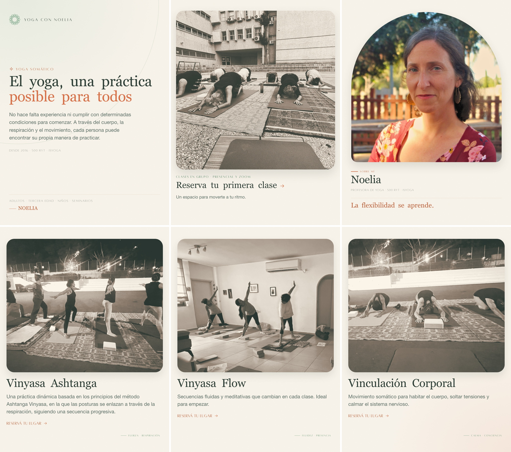

# Instagram · Mosaico 3 × 2

Seis publicaciones en **4:5 (1080 × 1350 px)** que, al verlas juntas en el
perfil, arman un póster 3×2. Usan la paleta, las tipografías y las fotos del
rediseño de la web.

La grilla de Instagram muestra cada post recortado a **3:4**, así que
`grid-preview.jpg` simula ese recorte: todo el contenido importante queda dentro
del área segura. Los archivos de `posts/` son los 4:5 completos que se suben.



## Qué hay en esta carpeta

```
instagram/
├── posts/                 ← las 6 piezas para subir + vista previa
│   ├── 01-marca.jpg
│   ├── 02-hero.jpg
│   ├── 03-sobre-mi.jpg
│   ├── 04-vinyasa-ashtanga.jpg
│   ├── 05-vinyasa-flow.jpg
│   ├── 06-vinculacion-corporal.jpg
│   └── grid-preview.jpg
├── posts-he/              ← 6 versiones en hebreo para el segundo slide
│   ├── 01-marca-he.jpg
│   ├── 02-hero-he.jpg
│   ├── 03-sobre-mi-he.jpg
│   ├── 04-vinyasa-ashtanga-he.jpg
│   ├── 05-vinyasa-flow-he.jpg
│   ├── 06-vinculacion-corporal-he.jpg
│   └── preview-he.jpg
├── perfil/                ← 4 opciones de avatar para Instagram
├── captions.md            ← textos bilingües para cada post
├── alternativas/
│   ├── yoga-tercera-edad.jpg      ← opcional, se suma a la grilla
│   └── yoga-tercera-edad-he.jpg   ← su versión en hebreo
├── source/                ← fotos originales y recortes reales
├── _design/               ← HTML editable, logo, preparación de fotos
└── build.sh               ← vuelve a renderizar todo
```

La alternativa de tercera edad tiene las dos versiones: usá
`alternativas/yoga-tercera-edad.jpg` como portada y
`alternativas/yoga-tercera-edad-he.jpg` como segundo slide.

### Fotos reales usadas

- **02 · Hero:** `new-hero-sepia.jpg`, la foto real del sitio con el mismo
  blanco y negro cálido de las clases.
- **03 · Sobre mí:** `noelia-hero.jpg`, el retrato real.
- **04 · Ashtanga:** `IMG_3198.jpeg`, la clase nocturna en guerrero II.
- **05 · Flow:** `IMG_0599.heic`, la clase de interior.
- **06 · Vinculación Corporal:** `IMG_3199.jpeg`, la postura de niño nocturna.
- **Alternativa:** `IMG_6762.HEIC`, la clase de tercera edad con pelotas.

Las tres fotos de clases se pasaron a un blanco y negro cálido para unificar
las luces y que la fila de abajo se lea como una serie. Los recortes finales
están en `source/real-ashtanga.jpg`, `real-flow.jpg` y `real-somatico.jpg`.

Las piezas están en **1080 × 1350 px (4:5)**, JPG calidad 95, en sRGB. No las
recortes ni les apliques filtros dentro de Instagram: subí el archivo tal cual.
La grilla las recorta a 3:4, pero el diseño ya deja márgenes suficientes para que
no se corte nada importante.

### Si ya las publicaste

Las versiones nuevas son 4:5. Las cuadradas que ya están en el perfil van a
seguir viéndose recortadas en la grilla: eliminá o archivá esas seis y volvé a
subir estas. `grid-preview.jpg` ya muestra el recorte 3:4 real del perfil.

## Orden para subirlas

Instagram muestra lo más nuevo primero, de izquierda a derecha. Para que el
mosaico quede así:

```
01  02  03
04  05  06
```

subí los carruseles **al revés**. Si no usás la versión en hebreo, subí solo el
Slide 1 de cada uno:

| Orden de subida | Slide 1 (portada)             | Slide 2 (hebreo)                 | Queda en              |
| --------------- | ----------------------------- | -------------------------------- | --------------------- |
| 1.º             | `06-vinculacion-corporal.jpg` | `06-vinculacion-corporal-he.jpg` | abajo a la derecha    |
| 2.º             | `05-vinyasa-flow.jpg`         | `05-vinyasa-flow-he.jpg`         | abajo al centro       |
| 3.º             | `04-vinyasa-ashtanga.jpg`     | `04-vinyasa-ashtanga-he.jpg`     | abajo a la izquierda  |
| 4.º             | `03-sobre-mi.jpg`             | `03-sobre-mi-he.jpg`             | arriba a la derecha   |
| 5.º             | `02-hero.jpg`                 | `02-hero-he.jpg`                 | arriba al centro      |
| 6.º             | `01-marca.jpg`                | `01-marca-he.jpg`                | arriba a la izquierda |

Después de subir la última, revisá el perfil: debería verse el póster completo.

### Versión en hebreo (carrusel)

Cada publicación puede ser un carrusel de dos imágenes:

1. **Slide 1:** la pieza en español. Es la portada que se ve en la grilla y la que
   arma el mosaico.
2. **Slide 2:** la misma pieza en `posts-he/`. Se ve al deslizar y no cambia el
   mosaico.

Al crear el carrusel, elegí **primero la imagen española y después la hebrea**.
Las dos tienen que ser 4:5 (todas las piezas lo son). Si las elegís al revés, la
portada de la grilla queda en hebreo y se rompe el mosaico.

Las piezas hebreas son independientes (no están pensadas para formar un póster
entre ellas), así que podés subirlas en el mismo orden de la tabla: 06 → 01.

### Si querés fijarlas

Instagram permite fijar solo **3 publicaciones**. La opción más prolija es fijar
la fila de arriba (01, 02 y 03) para que la cabecera quede siempre visible.
Como la portada de cada carrusel es la española, las tres fijadas mantienen el
mosaico en español.
Fijá primero `03`, después `02` y por último `01`; Instagram suele mostrar
primero la última que fijaste. Si quedan al revés, desfijá y hacelo en el orden
inverso.

El mosaico completo se mantiene mientras estas seis sean las últimas
publicaciones. Cuando publiques algo nuevo, la grilla se corre: las tres fijadas
quedan arriba y la fila de clases baja.

## Avatar de perfil

En `perfil/` hay cuatro avatares de 1080 × 1080 con el mismo loto del header.
Subí el PNG o el JPG tal cual: Instagram lo recorta en círculo.

- `avatar-salvia-crema` — fondo salvia y loto crema. **Recomendado** para que se
  distinga en la interfaz de Instagram.
- `avatar-arena-salvia` — fondo arena y loto salvia, igual que el header del
  sitio.
- `avatar-tinta-salvia` — fondo tinta y loto salvia.
- `avatar-salvia-disco` — fondo salvia con disco crema.

## Textos para copiar y pegar

Los captions bilingües (español + hebreo) de las seis piezas y de la
alternativa están en [`captions.md`](captions.md).

## Hashtags

Agregalos al final del caption o en el primer comentario:

```text
#yogaconnoelia #yogasomatico #movimientosomatico #vinyasa #ashtanga
#yogaterceraedad #yogaparaniños #yogaisrael #yogatelaviv #telaviv
#yogaenespañol #bienestarcorporal #respiraciónconsciente #cuerpoymente
```

También hay una lista opcional en hebreo en [`captions.md`](captions.md).

## Texto alternativo (ALT)

Instagram permite agregar una descripción a cada foto. Estas son sugerencias:

- **01:** Pieza gráfica de Yoga con Noelia con el texto «El yoga, una práctica posible para todos» sobre fondo arena, con el logo de loto.
- **02:** Clase de yoga al aire libre en blanco y negro, con un grupo de personas en postura de niño sobre esterillas.
- **03:** Retrato de Noelia, profesora de yoga, enmarcado en un arco verde salvia.
- **04:** Clase de yoga al aire libre de noche, en blanco y negro cálido, con cinco alumnas en postura de guerrero II.
- **05:** Clase de yoga en un living luminoso, con tres alumnas estirando los brazos en una postura lateral.
- **06:** Clase de vinculación corporal nocturna al aire libre, con alumnas en postura de niño sobre esterillas.
- **Alternativa:** Personas mayores practicando con pelotas de estabilidad en una clase adaptada.

## Notas de diseño

- **Paleta:** arena `#F8F3EA`, salvia `#68A37B`, terracota `#DA7048`, tinta `#2F4038`.
- **Tipografías:** Dorian para los títulos y Alta para las etiquetas, las mismas
  de la web.
- **Fotos:** el hero, el retrato y las tres clases son fotos reales. Las clases
  se recortaron a 4:3 y se unificaron en blanco y negro cálido; los archivos
  editados son `source/real-*.jpg`. Las versiones generadas con IA quedan en
  `source/` como respaldo, pero no se usan en el mosaico.
- **Web:** la página también usa `src/public/new-hero-sepia.jpg`, así el hero
  del sitio y el del mosaico quedan exactamente iguales.
- **Avatar:** el loto del header en salvia y crema, con el mismo fondo arena de
  la web.
- **Hebreo:** las piezas de `posts-he/` usan el mismo diseño en RTL, con Dorian
  para los títulos y el mismo tratamiento de fotos. Son slides independientes,
  no un segundo mosaico.

## Volver a generar o editar

Editá `_design/poster.html` (textos, colores, encuadres) y ejecutá:

```bash
./instagram/build.sh
```

Necesitás Google Chrome y Python 3 con Pillow. El script renderiza el póster a
3240 × 2700, lo corta en las seis piezas 4:5 y actualiza la vista previa. También
genera `posts-he/` desde `_design/poster-he.html`. Las alternativas se generan
desde `_design/poster-alt-tercera-edad.html` y
`_design/poster-he-alt-tercera-edad.html`; si cambiás el diseño general,
actualizá también esos archivos.

Para rehacer los recortes de las fotos reales:

```bash
python3 instagram/_design/prepare-photos.py
```

Si querés las clases en color en vez de blanco y negro cálido, sacá el
`warm_bw(...)` de `prepare-photos.py` y volvé a correr los dos comandos.
